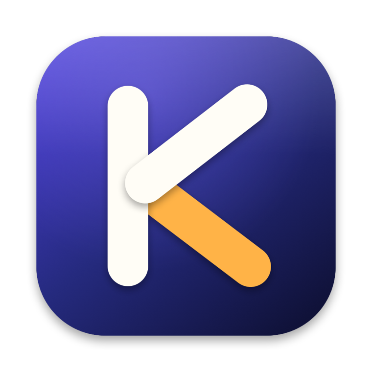
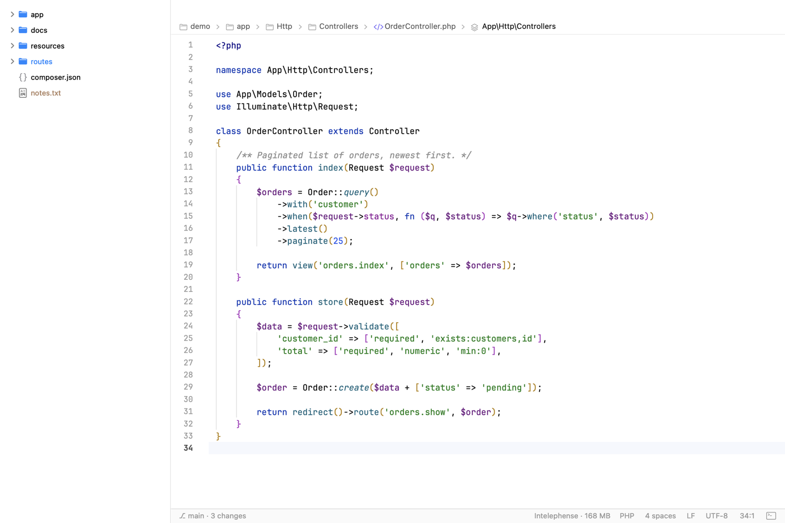
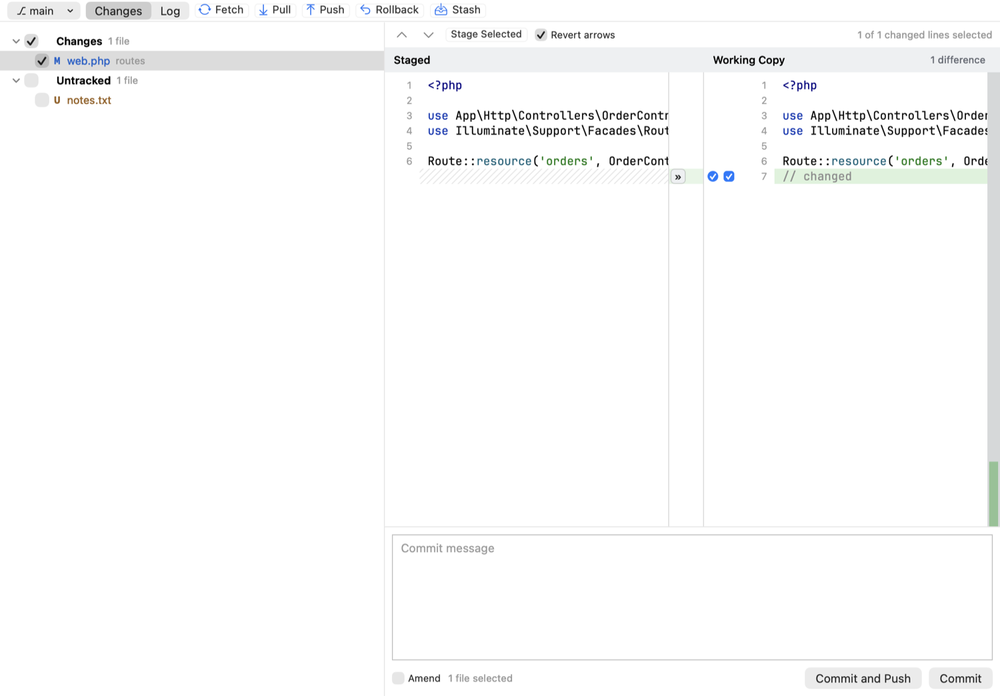
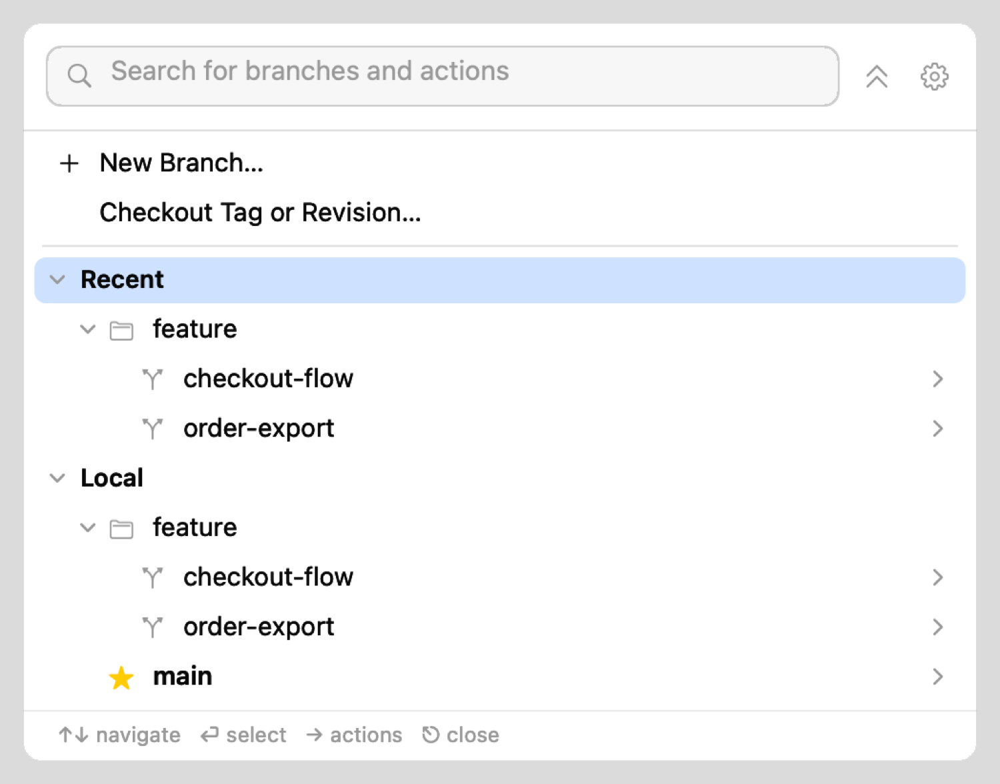
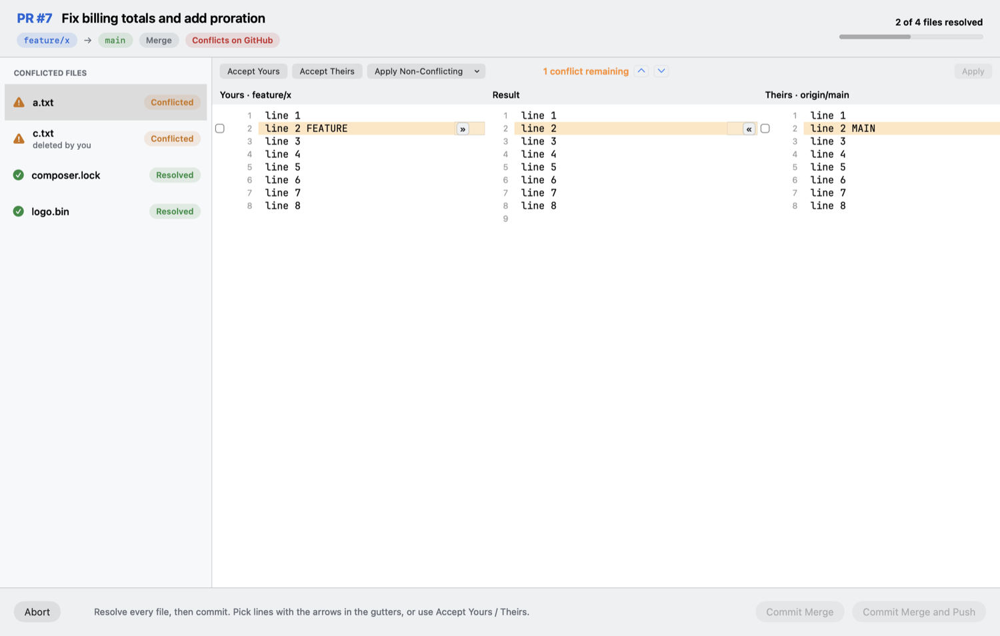
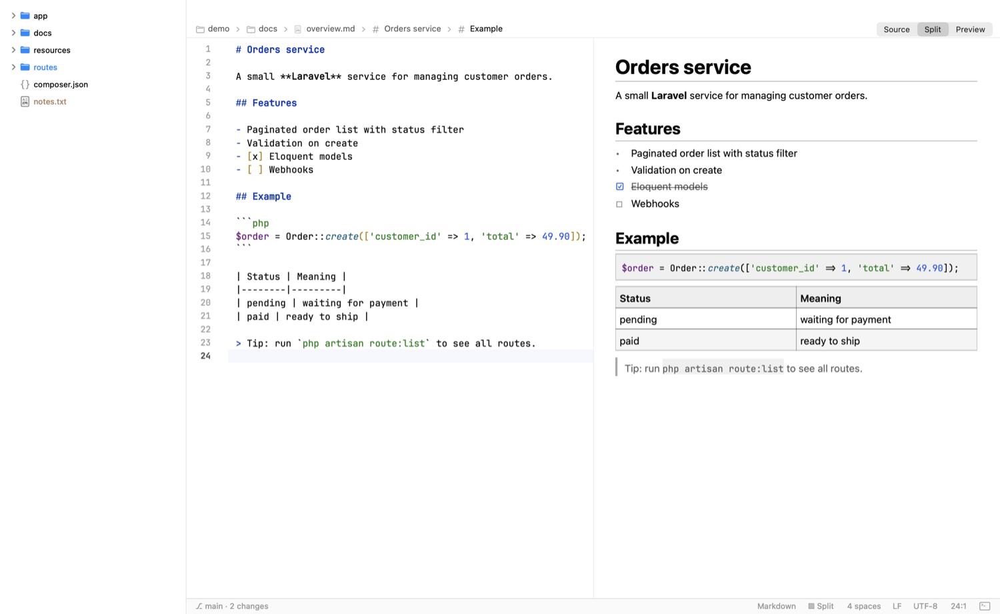

<p align="center"></p>

# Kode

A light, native macOS code editor (Swift/AppKit) built as a low-memory alternative to PhpStorm for Laravel/PHP, Blade, JS/TS, Vue/React, HTML and CSS work. It sits next to CLI AI tools such as Claude Code or Gemini, and talks to Claude Code directly.



## Highlights
- **Fast and small:** native Swift, TextKit, tree-sitter syntax highlighting (PHP, Blade, JS/TS/TSX, HTML, CSS/SCSS, JSON, YAML, Markdown, Bash, XML), bracket pair colouring, code folding, breadcrumbs, inline Git blame, JetBrains Mono, IntelliJ Light / Darcula themes. A power-saver mode follows Low Power Mode, battery and thermal state.
- **Code intelligence:** a built-in fast tier for Laravel and PHP (routes, views, config, env, translations, Eloquent columns and relations, class imports), plus language servers started lazily per project: Intelephense, TypeScript, HTML/CSS/JSON, Tailwind and Volar. ⌃Space completion, hover, go to definition, rename, diagnostics.
- **Laravel navigation:** ⌘-click on views, routes, config, env, lang keys, components and Livewire.
- **PhpStorm-style Git:** ⌘K Commit window with line-by-line picking, a branch widget and popup in the title bar, side-by-side diff and 3-way merge, log, stash, push.
- **Search:** fuzzy file, class and symbol search (⌘⇧O, ⌘O, ⇧⇧), find in files, docked terminal (⌥F12).
- **Viewers:** live Markdown preview with synced scrolling, JSON and YAML tree viewers with diagnostics, and Compose / GitHub Actions / `package.json` suggestions.
- **Claude Code integration:** Kode is an IDE for the `claude` CLI. It shares your selection, opens Claude's proposed edits in a diff you accept or reject, and shows diagnostics. See [docs/claude-code-bridge.md](docs/claude-code-bridge.md).

## Screenshots

### Commit window (⌘K)


### Branches, the PhpStorm way


### Pull request conflict resolver
Enter a PR number (or URL), resolve the conflicts in a 3-way merge, then commit and push.



### Markdown preview with synced scrolling


## Build and install
```sh
./build-app.sh          # dist/Kode.app (ad-hoc signed)
./scripts/make-dmg.sh   # dist/Kode-<version>.dmg
```
Requires the Swift toolchain (`swift build --build-system native` is used). On another Mac, the first launch of an ad-hoc signed app needs right-click → Open.

## One instance or many
By default every project opens as a window in one process, which shares the Swift runtime, themes and caches, so it uses the least RAM. For crash and language-server isolation (one project's Intelephense or Volar can't slow or take down another), use File ▸ Open Project in New Instance, hold ⌥ in File ▸ Open Recent, or set Settings ▸ Projects ▸ Open projects in ▸ New instance. Each extra instance is a separate process and costs roughly 60–90 MB more, plus its own language servers.

A project open in another instance is focused instead of being opened twice (`~/Library/Application Support/CodeEditor/instances`, PID-checked, stale entries from crashes are ignored). The first instance owns window restore; instances started with `--project <path>` (what "new instance" runs: `open -n -a Kode.app --args --project <path>`) open only that folder and never overwrite the restore list.

## Checks
`CE_SELFTEST=1 dist/Kode.app/Contents/MacOS/Kode` runs the logic self-tests, and `CE_SNAPSHOT=1` renders headless screenshots (the images above come from it, using a throwaway sample project).

The app name lives in `Sources/CodeEditor/Brand.swift`.
